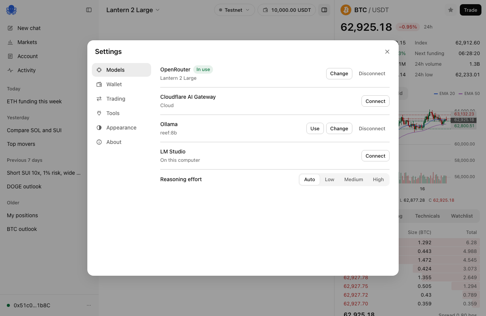
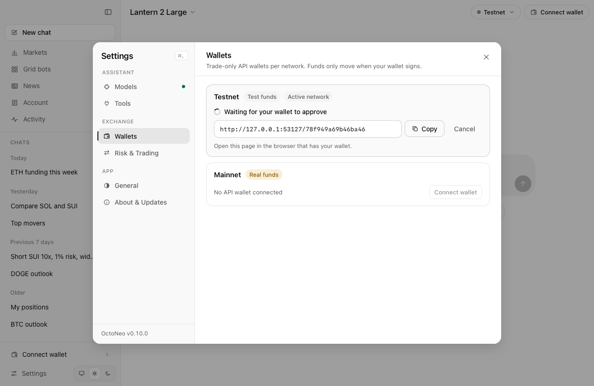
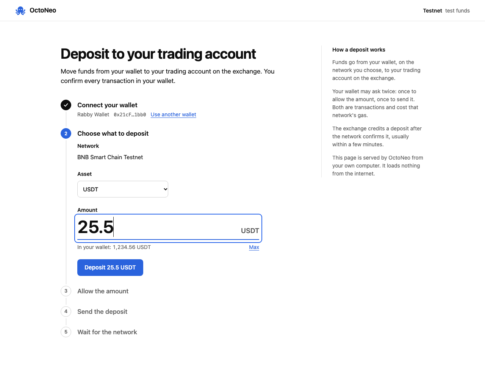
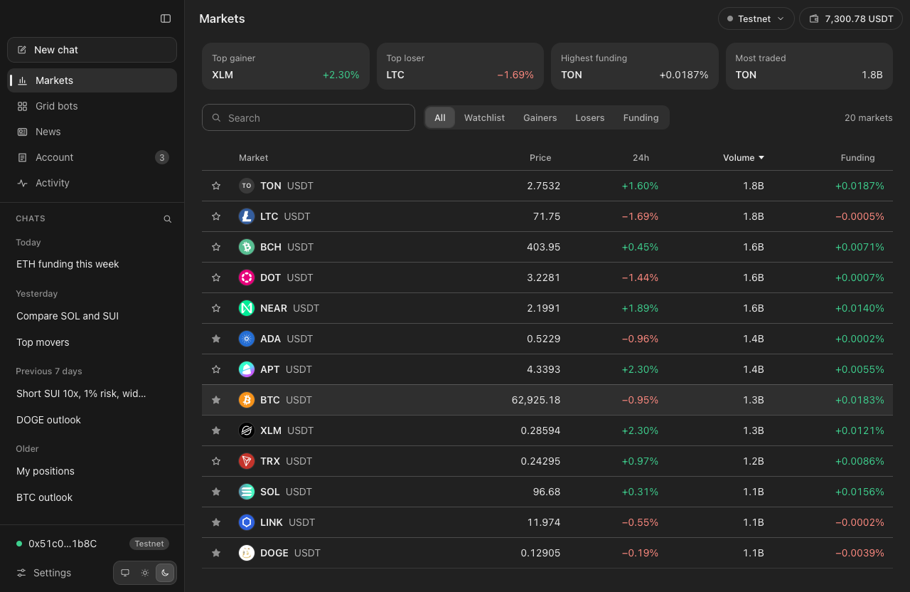
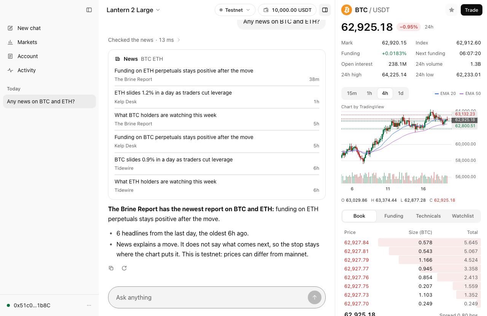
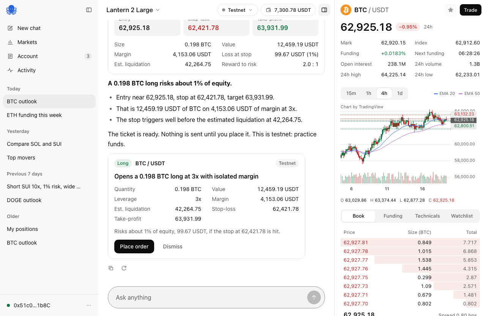
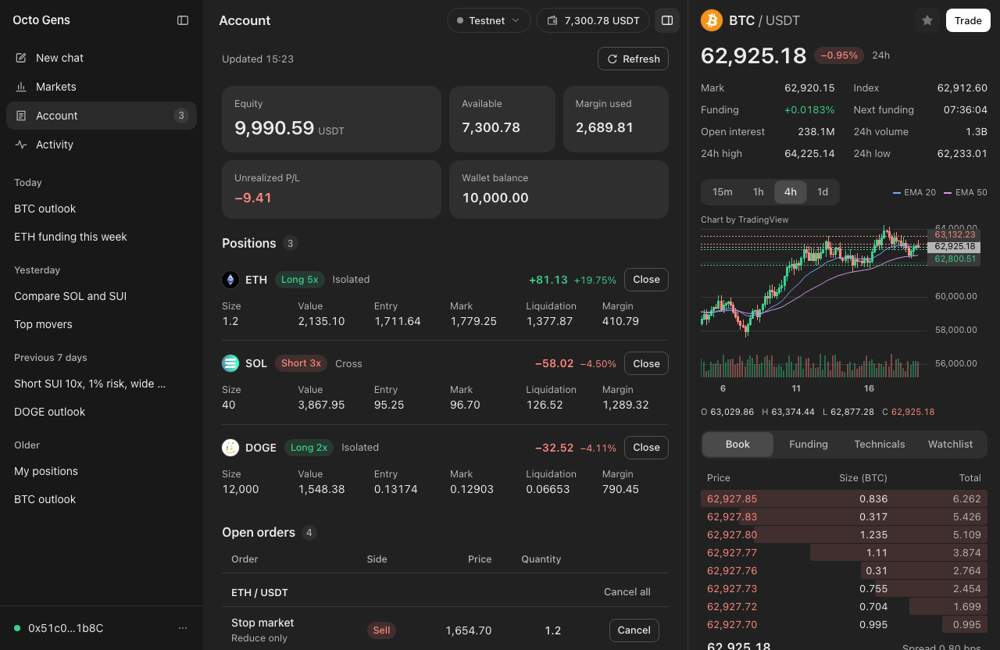

# OctoNeo

Website: [octoneo.xyz](https://octoneo.xyz). Download the [latest release](https://github.com/kerjakuyco/octo-neo/releases/latest) for Windows, macOS (Apple silicon) or Linux.

OctoNeo is a desktop AI trading assistant for perpetual futures on a decentralised exchange. You chat with it the way you chat with any AI assistant. It reads live market data, sizes positions from the risk you accept, and drafts order tickets. You trade from your own web3 wallet and confirm every order. It runs on Windows, macOS and Linux.


- **Just ask.** "BTC outlook", "Top movers", "Long ETH, 1% risk". The assistant plans its own research and shows what it read as cards under the answer: prices, a technical reading, the order book, a position plan.
- **Bring your own model.** OpenRouter, Cloudflare AI Gateway, or a model on your own computer with Ollama or LM Studio.
- **Market data in depth.** A screener of every market and a page for each one: a chart with moving averages, Bollinger bands and support and resistance, the order book and latest trades, funding history and open interest, and technical readings on four timeframes.
- **The news, read for you.** Ask why a market is moving. The assistant reads the latest headlines from crypto newsrooms, Yahoo Finance and the Federal Reserve, says who reported what and how long ago, and lists the headlines with links. Ask about a share or a commodity the exchange lists and it reads the news filed under that ticker too. It works with every model, and needs no key.
- **A news page.** The newest stories from the same newsrooms, laid out like a magazine with their pictures. Narrow it to your watchlist, to crypto or to the economy, or to one newsroom, and open a market from the story that names it. A story opens right inside the app.
- **You stay in control.** The assistant can only draft a ticket. Nothing reaches the exchange until you confirm it, and the assistant may not draft mainnet tickets until you allow it.
- **Your wallet, your funds.** Your wallet approves a separate trade-only key for the app. The app never sees your wallet's key, and the key it holds cannot withdraw.
- **Deposit and withdraw without leaving.** Both start in the app and are confirmed by your own wallet. You never have to visit the exchange's site.
- **Mainnet and testnet.** Trade on mainnet, or switch to the testnet for the same order flow with test funds.

## Install

Installers for Windows, macOS (Apple silicon) and Linux are attached to each release on the [Releases page](https://github.com/kerjakuyco/octo-neo/releases). If there is no release for your system yet, [build it yourself](#build-from-source).

The app opens on **mainnet** prices. Market data needs no wallet, no account and no model.

1. [Connect a model](#connect-a-model). The first launch asks for one.
2. Ask **BTC outlook**. The answer comes with the readings it is based on.
3. [Connect a wallet](#connect-a-wallet). To trade with test funds, switch to **Testnet** at the top.
4. Ask **Long 0.01 BTC**. The assistant picks a stop-loss, says where it put it, and drafts a ticket. Review it, then place the order. Ask **Close my BTC** to exit.

`Ctrl+K` (Windows, Linux) or `Cmd+K` (macOS) puts the cursor in the message box, and `Ctrl+B` or `Cmd+B` shows or hides the sidebar. `Esc` stops a running answer.

## Connect a model

Every message is answered by a language model, so the app needs one. Open **Settings**, then **Models**, and pick a provider.

| Provider | Where the model runs | What it needs |
| --- | --- | --- |
| OpenRouter | In the cloud | An [OpenRouter key](https://openrouter.ai/keys). Pick any model that supports tools; the list shows context size and price. OpenRouter bills you for what the model uses. |
| Cloudflare AI Gateway | In the cloud | Your Cloudflare account ID, an API token with the *Workers AI Read* permission, and a model such as `openai/gpt-4.1` or one of Cloudflare's own. Cloudflare bills your account. |
| Ollama | On your computer | [Ollama](https://ollama.com) running, with a model that supports tools, for example `ollama pull qwen3:8b`. |
| LM Studio | On your computer | [LM Studio](https://lmstudio.ai) with its local server started and a model trained for tool use. The app loads the model for you. |



The app checks a model before it keeps it: the key or token must be accepted, and the model must be able to call tools, because that is how the assistant reads the market and drafts tickets. A model on your computer keeps your conversations on your computer. It works in a smaller context than a cloud model, so pick the largest one your machine runs comfortably.

## Connect a wallet

OctoNeo trades through an **API wallet**: a separate key that your own wallet approves for trading perpetuals. It is approved without spot trading and without withdrawal. Open **Settings**, then **Wallet**, and choose one of two ways. Each network has its own wallet.

| Way | What happens | Good for |
| --- | --- | --- |
| Approve in a browser wallet | The app creates a key on your computer and opens a page it serves locally. Your wallet (MetaMask, Rabby and others) signs one approval for that key, for 7 to 180 days. | Most people |
| Paste an API wallet key | You create an API wallet on the exchange's own API wallet page, which the app opens for you, and paste its key together with your wallet address. | Hardware wallets, or keys you manage yourself |



Things to know:

- **Deposit first.** The exchange serves an account only after the wallet's first deposit, on testnet too. Until then the app shows the wallet as waiting for its deposit, with a **Deposit** button.
- **One-way mode.** The app keeps one net position per market. An account in hedge mode is shown with an explanation and is not traded.
- **Ending access.** *Disconnect* forgets the key on this computer. The approval itself ends on its expiry date, or sooner if you remove it on the exchange's API wallet page.

## Deposit and withdraw

Funds move between your own wallet and your trading account. **Deposit** and **Withdraw** are in **Settings** under *Wallet*, and on the **Account** page. Each opens a page the app serves on your computer, in the browser where your wallet is, like the approval does.

| | What your wallet does | What the app does |
| --- | --- | --- |
| Deposit | Sends the deposit to the exchange's vault, after allowing the vault exactly that amount of the token | Builds the transactions, checks the vault with the exchange first, and records the deposit under **Activity** |
| Withdraw | Signs the withdrawal, then the request that carries it | Checks both signatures are yours, sends the request once, and records it |



- **Where funds move.** Mainnet: BNB Smart Chain, Ethereum and Arbitrum One. Testnet: BNB Smart Chain Testnet and Sepolia.
- **Only your own wallet.** A deposit is credited to the connected wallet, and a withdrawal is paid out to it. There is no field for another address.
- **The app's key cannot do this.** It is approved without withdrawal. Nothing moves without your wallet's own confirmation, every time.
- **MetaMask and withdrawals.** The exchange asks for a signature that names its own network, and MetaMask signs only for the network it is on, so it refuses. Rabby and other wallets that sign across networks work. Deposits work with every wallet.

[docs/exchange.md](docs/exchange.md#deposits-and-withdrawals) has the details, including the vault addresses.

## Market data



| Where | What it shows |
| --- | --- |
| **Markets** | Every market the exchange lists, most traded first: price, 24h change, volume and funding. Sort by any column, search, add a market to your watchlist, and pick one to open its page. |
| A market's page | A chart on 15m, 1h, 4h and 1d, with EMA 20 and 50, EMA 200, Bollinger bands, support and resistance, and your position and orders drawn on it as you choose. Above it, the mark and index prices, funding and the time to the next payment, open interest and the 24h range; below it, the trend on each timeframe, volatility and relative volume. Your position and open orders in the market, with **Close** and **Cancel**. |
| *Book* | The best bids and asks with their running size, the spread, the share of resting size on each side, and the latest trades with how much of their value came from buyers and from sellers. |
| *Funding* | The rate now and what it comes to over a year, two weeks of settled rates, and open interest. |
| *Technicals* | Trend, RSI, MACD, ATR, moving averages, support and resistance on four timeframes side by side. Click a level to put it in the order form as a stop-loss or a take-profit. |
| *Watchlist* | Your markets with a 90-day sparkline each. |

A market's page opens from **Markets**, from a market named in an answer, or from a position under **Account**. **Back** returns to where you were, and the market's name at the top switches to another. With a model connected, **Ask AI** puts a question about the market to the assistant. The market data comes straight from the exchange: none of it needs a wallet or a model.

## What the assistant can do

| It can | It cannot |
| --- | --- |
| Read prices, mark prices, funding, candles and order books | Place, change or cancel an order |
| Find the biggest movers across the whole exchange | See or handle any key |
| Compute trend, momentum, volatility and support/resistance | Withdraw, transfer or deposit: that is yours to do, with your own wallet |
| Read your account: equity, positions, liquidation prices, open orders | Draft a mainnet ticket unless you allowed it in Settings |
| Size a long or a short from a stop and a risk percentage, and check the stop against liquidation | Open or add to a position without a stop-loss |
| Draft a ticket for you to confirm, with a stop-loss | Call tool-server tools that are not marked read-only |
| Read recent headlines from crypto newsrooms, Yahoo Finance and the Federal Reserve, and the article behind one | Read a page it was not given: only its news results and links you paste |
| Call read-only tools of a tool server you attached | Answer without a model: there are no canned replies |



Conversations are kept in the sidebar, where you can filter them by title. Open one to read it again with what the assistant read at the time, or delete it.

How the assistant is instructed, every tool it has, and how each provider is handled is documented in [docs/assistant.md](docs/assistant.md).

## How orders work



- **Tickets.** Every order starts as a ticket: what it does to your position, its value, the margin it needs and an estimated liquidation price. It is checked against your live account before you see it, and sent only when you confirm. A mainnet ticket also asks you to tick an acknowledgement.
- **Two ways to draft one.** Ask the assistant, or use **Trade** on a market's page, which needs no model.
- **Checked twice.** When you confirm, the app reads your position and the mark price again. If either has moved away from what the ticket says, nothing is sent and you draft a fresh one.
- **Market orders.** Tickets are market orders, sized in the asset or by value. Limit orders are not supported yet.
- **Leverage and margin.** A new position uses the leverage on the ticket, up to your limit, and isolated margin unless you choose cross. A new installation limits leverage to 3x; you can raise the limit to 50x in **Settings** under *Trading*. An existing position keeps the leverage and margin mode it has.
- **Stop-loss and take-profit.** They are placed right after the entry as reduce-only orders that trigger on the mark price. A stop beyond the estimated liquidation price is refused, because liquidation would come first. If the exchange refuses one after the entry has filled, the ticket says so plainly.
- **Closing.** Ask the assistant, or press **Close** on a position under **Account** or on the market's page. Either drafts a ticket for the whole position. Confirming it also cancels the reduce-only orders left on that position. One order never flips a long into a short.

**Account** shows equity, positions with the exchange's liquidation prices, and open orders. It is read from the exchange again every 15 seconds while the window is in view. **Activity** lists what the app did on the exchange: each order and cancellation, step by step.



[docs/exchange.md](docs/exchange.md) describes exactly what the app sends to the exchange and how it signs.

## Your data

Everything stays on your computer.

| What | Where |
| --- | --- |
| Conversations, activity, preferences | Windows `%LOCALAPPDATA%\Octo Gens\`, macOS `~/Library/Application Support/Octo Gens/`, Linux `~/.local/share/octo-gens/` |
| API wallet keys, OpenRouter key, Cloudflare API token | Your system keychain, under `org.octogens.desktop` |

The folder and the keychain entry keep the name the app had before it was called OctoNeo, so an existing install keeps its wallet, settings and conversations.

The interface has no network access of its own. Requests go from the app's core directly to the exchange, to the model provider you chose, to GitHub when the app starts (to see whether a newer release is out) and, while web search is on, to news publishers and the sites that serve their pictures. Nowhere else. There is no telemetry. An article you open on the **News** page is the exception: it loads in a separate browser view inside the window, as it would in your browser.

- With a cloud model, your messages and what the assistant reads for them, including the account summary, go to that provider. With Ollama or LM Studio they stay on your computer.
- With web search on, the app downloads the public news feeds of [seven publishers](docs/assistant.md#news-and-web-pages), the pictures of the stories on the **News** page, and the articles the assistant reads. They see a request from your computer, as any site you visit does. An article you open on the **News** page is loaded by the in-app browser view with its own scripts and ads, and keeps no cookies once you close it. What you type is not sent to them: a news search is answered on your computer, from the feeds already downloaded. The one exception is the ticker of a share, a fund or a commodity you ask about, which goes to Yahoo Finance because it files its news by ticker. Turn web search off in **Settings** under *Tools*.
- The journal keeps your conversations, which can include account figures the assistant quoted. Deleting a conversation removes it from the journal.

| Environment variable | Effect |
| --- | --- |
| `OCTONEO_DATA_DIR` | Use another data folder |
| `OCTONEO_NO_KEYCHAIN` | Keep keys in memory for the session instead of the system keychain. Meant for tests |
| `OCTONEO_MAINNET_URL`, `OCTONEO_TESTNET_URL` | Send a network's API requests to another origin. Meant for tests; see [docs/exchange.md](docs/exchange.md) |

## Build from source

You need [Rust](https://rustup.rs) (stable), [Node.js](https://nodejs.org) 20 or newer with [pnpm](https://pnpm.io) 10, and the [Tauri system dependencies](https://tauri.app/start/prerequisites/) for your platform.

```sh
pnpm install
pnpm tauri dev      # run the app with hot reload
pnpm tauri build    # build the installer for this platform
```

To work on the interface alone, `pnpm dev` runs it in a browser against a built-in mock of the core.

## Project layout

```
crates/octoneo-core/    Trading core in Rust: exchange client, wallet signing, indicators, news, model providers, assistant. No UI.
src-tauri/              Desktop shell: window, keychain, one command per core action.
src/                    Interface in React and TypeScript.
docs/                   Architecture, the assistant, the exchange.
scripts/                Smoke test for the built app.
site/                   The project's website: static pages served by Cloudflare Workers. See site/README.md.
```

[docs/architecture.md](docs/architecture.md) explains how the parts fit together.

## Contributing

Bug reports, ideas and pull requests are welcome. Start with [CONTRIBUTING.md](CONTRIBUTING.md). To report a security problem, follow [SECURITY.md](SECURITY.md) instead of opening a public issue.

## License

[GPL-3.0-only](LICENSE). Third-party notices are in [NOTICE.md](NOTICE.md).

OctoNeo is not financial advice. Trading perpetual futures carries risk.
