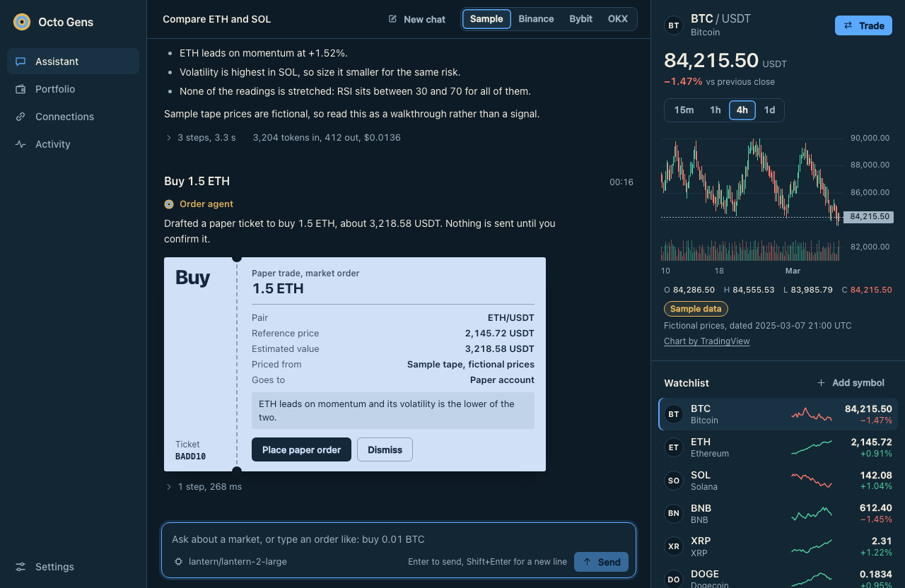

# Octo Gens

Octo Gens is a desktop AI trading assistant for crypto spot markets. You chat with it; it researches with live exchange data, sizes positions, and drafts order tickets. You confirm every order. It runs on Windows, macOS and Linux.



- **An assistant that works the desk.** With an OpenRouter model it plans its own research: quotes, multi-timeframe technical readings, order-book depth, cross-exchange prices, your portfolio, position sizing.
- **You stay in control.** The assistant can only draft a ticket. Nothing is bought or sold until you confirm it, and live tickets from the assistant are off until you allow them.
- **Binance, Bybit and OKX with no setup.** Public market data needs no account. Add API keys only for balances and live orders.
- **Paper trading from the first launch.** Every price feed has its own simulated USDT account. A built-in sample tape works offline.
- **Works without a model too.** Built-in agents handle quotes, comparisons, your portfolio and typed orders such as `buy 0.01 BTC`.

> [!WARNING]
> Octo Gens is early software and not financial advice. Markets can move against you quickly. Try the paper account first, and trade live only with money you can afford to lose.

## Install

Installers for Windows, macOS and Linux are attached to each release on the [Releases page](https://github.com/kerjakuyco/octo-gens/releases). If there is no release for your system yet, [build it yourself](#build-from-source).

The app opens on the **sample tape**: fictional prices and 100,000 USDT of paper cash, so you can try everything safely.

1. Type **Compare BTC and ETH**. The answer shows each reading and the steps that produced it.
2. Type **Buy 0.01 BTC**. Review the ticket, then place the paper order.
3. Pick **Binance**, **Bybit** or **OKX** at the top to switch to live prices.

`Ctrl+K` (Windows, Linux) or `Cmd+K` (macOS) puts the cursor in the message box. `Esc` stops a running answer.

## Choose a model

Open **Settings** and pick who answers.

| Option | What you get | What it needs |
| --- | --- | --- |
| Built-in agents | Quotes, comparisons with technical readings, portfolio review, typed orders | Nothing |
| OpenRouter | The full assistant. A tool-calling model plans its own research and drafts tickets; other models explain readings the desk gathers | An [OpenRouter key](https://openrouter.ai/keys) |
| Ollama | A model on your computer explains readings the desk gathers | [Ollama](https://ollama.com) running locally |

The model list shows which models can call tools, their context size and their price. OpenRouter bills you for what the model uses.

## What the assistant can do

| It can | It cannot |
| --- | --- |
| Read prices, candles, order books and 24h statistics | Place, change or cancel an order |
| Compute trend, momentum, volatility and support/resistance | See or handle your API keys |
| Compare a pair across Binance, Bybit and OKX | Call exchange tools that are not marked read-only |
| Read your paper account, and real balances when you ask | Draft a live ticket unless you allowed it in Settings |
| Size a position from a stop and a risk percentage | Trade anything but USDT spot pairs |
| Draft a ticket for you to confirm | |

How the assistant is instructed, and every tool it has, is documented in [docs/assistant.md](docs/assistant.md).

## Exchanges

| Exchange | Market data | Balances and live orders | Official MCP server |
| --- | --- | --- | --- |
| Binance | Ready | With API keys | None published |
| Bybit | Ready | With API keys | Optional, needs Node.js 20+ |
| OKX | Ready | With API keys and passphrase | Optional, needs Node.js 20+ |

- **Instruments.** USDT spot pairs. The watchlist starts with ten major tokens and four tokenized stocks (xStocks such as `TSLAx`); add any token the active exchange lists. A tokenized stock is its own market: asking for `TSLA` is refused, never swapped for the token.
- **API keys.** Add them in **Connections**. They are checked with a balance read, held in memory, and stored in your system keychain only if you tick *Remember*. Create keys with trading permission but **without withdrawal permission**.
- **Live orders** are market orders in token units, sent only after you confirm the ticket.
- **Blocked networks.** Some networks block exchange domains. Binance market data then falls back to Binance's own public data host. For anything else the app tells you the connection was refused; use another network or a VPN.
- **MCP servers.** In **Connections** you can attach an exchange's official [Model Context Protocol](https://modelcontextprotocol.io) server, your own command, or a remote HTTPS endpoint. The assistant may call only the tools a server marks read-only. See [docs/exchanges.md](docs/exchanges.md).

## Your data

Everything stays on your computer.

| What | Where |
| --- | --- |
| Paper accounts, run journal, preferences | Windows `%LOCALAPPDATA%\Octo Gens\`, macOS `~/Library/Application Support/Octo Gens/`, Linux `~/.local/share/octo-gens/` |
| OpenRouter key, remembered exchange keys | Your system keychain |

The interface has no network access of its own. Requests go from the app's core directly to the exchange or model provider you chose, and nowhere else. There is no telemetry. Set `OCTOGENS_DATA_DIR` to use another data folder.

## Build from source

You need [Rust](https://rustup.rs) (stable), [Node.js](https://nodejs.org) 20 or newer with [pnpm](https://pnpm.io) 10, and the [Tauri system dependencies](https://tauri.app/start/prerequisites/) for your platform.

```sh
pnpm install
pnpm tauri dev      # run the app with hot reload
pnpm tauri build    # build the installer for this platform
```

To work on the interface alone, `pnpm dev` runs it in a browser against a built-in mock of the core.

## Project layout

```
crates/octogens-core/   Trading core in Rust: exchanges, paper ledger, indicators, assistant. No UI.
src-tauri/              Desktop shell: window, keychain, one command per core action.
src/                    Interface in React and TypeScript.
docs/                   Architecture, the assistant, exchanges.
scripts/                Smoke test for the built app.
```

[docs/architecture.md](docs/architecture.md) explains how the parts fit together.

## Contributing

Bug reports, ideas and pull requests are welcome. Start with [CONTRIBUTING.md](CONTRIBUTING.md). To report a security problem, follow [SECURITY.md](SECURITY.md) instead of opening a public issue.

## License

[GPL-3.0-only](LICENSE). Third-party notices are in [NOTICE.md](NOTICE.md).
